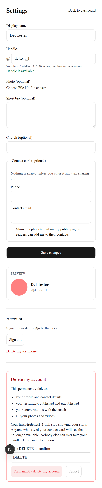
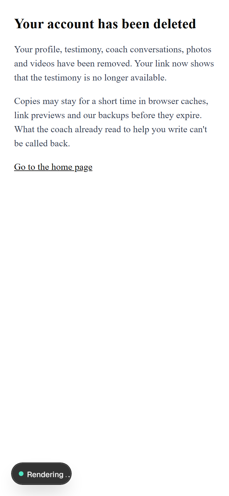
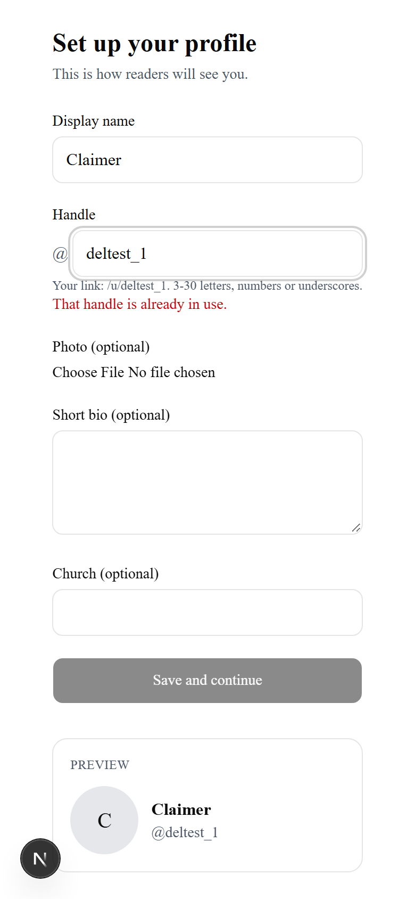

# Delete my account and all my data

## Summary
Authors can permanently delete their account from Settings. It removes their profile, testimony,
coach conversations, photos and videos (both storage buckets) and the sign-in account, then signs
them out and shows "Your account has been deleted". Anyone opening the old link or contact card
sees "This testimony is no longer available", and the handle can never be taken by someone else.

## Context
Issue #26 (private beta prerequisite, `docs/BETA_PLAN.md`). Before this, authors could only delete
their testimony (`/api/publish` action `delete`, US-12); the profile, photo and sign-in account
stayed. Acceptance: plain-language confirmation with a deliberate step; server route deletes only
the caller's data with public content first and safe retry; friendly page for the deleted link and
vCard; handle behavior per RC-03; unit tests.

## What changed
- `lib/account/delete.ts` (new): `deleteAccount(userId, ports)` runs the steps in a fixed order over
  an injected `DeletionPorts` interface, wraps failures in `AccountDeletionError(step)`, refuses a
  missing/invalid user id (`NotSignedInError`), and only removes listed storage paths that sit inside
  the caller's own prefix. `CONFIRM_WORD = "DELETE"`. No row-delete steps: the auth.users cascade
  removes the rows.
- `lib/account/supabase-ports.ts` (new): ports backed by the caller's RLS client (lookup, unpublish,
  publish re-check) and the service-role client (storage listing/removal, recursive and paginated; `auth.admin.deleteUser`,
  where 404 counts as done).
- `app/api/account/delete/route.ts` (new): `POST { confirm: "DELETE" }`; CSRF guard (Origin host must
  equal the request host or `NEXT_PUBLIC_SITE_URL`'s host, else 403; Content-Type must be
  `application/json`, else 415); `getUserOrNull()` (401 otherwise); user id only from the session; logs only the failed step name; signs out
  (`scope: "local"`) after success.
- `components/profile/delete-account.tsx` (new, client) and `app/settings/page.tsx`: a red-bordered
  "Delete my account" section below Account, separated by a rule. Opening it lists what is lost,
  says the link stops showing the story and the handle is never reused, and needs `DELETE` typed.
- `app/account-deleted/page.tsx` (new): plain confirmation page (noindex), including that copies may
  persist briefly in caches, link previews and backups, and that what the coach read cannot be recalled.
- `app/u/[handle]/page.tsx`: new `gone` state via `rpc("is_handle_retired")` (anon key), rendering
  "This testimony is no longer available / The author has removed it." Never-existing handles still
  404 as before.
- `app/api/vcard/[handle]/route.ts`: a retired handle redirects (307) to `/u/<handle>`, i.e. the same
  friendly page, instead of a bare 404.
- `components/profile/actions.ts` `checkHandle`: retired handles show as "already in use", checked with
  `rpc("is_handle_retired")` on the session client (no new service-role use).
- `supabase/migrations/0002_retired_handles.sql` (new), `lib/types.ts` (`RetiredHandle`).
- `docs/POLICY.md` §7 and §11, `docs/ARCHITECTURE.md` §3 and rule 4, `README.md` (apply all migrations).

### Deletion order
1. Look up own profile/testimony (RLS). 2. Unpublish (status `unpublished`, published copy cleared)
so the page goes dark. 3. `media-public/{testimony_id}/…`. 4. `media-public/avatars/{user_id}/…`.
5. `media-private/{user_id}/…`. 6. Re-check: if the testimony was published again meanwhile (another
tab), unpublish and clear public files again; if it is still published, stop with a retry message.
7. `auth.admin.deleteUser`: the ON DELETE CASCADE from `auth.users` removes profile, testimony, coach
messages, media rows (and reports, handle redirects) in one transaction; the `BEFORE DELETE` trigger
on `profiles` fires under the cascade and retires the handles. Then sign-out.

## Decisions and alternatives
- **Handles of deleted accounts are retired, not released (RC-03, POLICY §11).** RC-03: "a released
  handle is never reassigned to another user"; a link saved in contacts can never be updated, so it
  must never lead to a stranger's story. Without a change, deleting the profile frees
  `profiles.handle` and cascades away `handle_redirects`, so the handle would become claimable. New
  table `retired_handles (handle, retired_at)`, filled by a `BEFORE DELETE` trigger on `profiles`
  (current handle plus every old handle from `handle_redirects`), so it also works when the profile
  is removed by the `auth.users` cascade. `guard_handle()` is redefined to reject retired handles.
  Rejected: keeping a tombstone profile row (keeps a row tied to the person; conflicts with "delete
  all my data"); releasing the handle (violates RC-03).
- **No personal data kept.** Only the handle text and a timestamp; no user id. The handle was
  already public. `is_handle_retired(h)` answers one handle at a time (security definer), so the
  list cannot be enumerated; the table has RLS on with no policies.
- **Service role only where needed.** Lookups and unpublish use the caller's RLS client (RC-02).
  Service role is limited to storage (authors cannot write `media-public/{testimony_id}`) and
  deleting the auth user, in the deletion route only (RC-07; ARCHITECTURE rule 4 updated).
- **Migration hardening.** `retired_handles` has all grants revoked from anon/authenticated on top of
  RLS; execute on the trigger-only functions is revoked from public.
- **Rows deleted by the auth.users cascade, not step by step (security review).** The first version
  deleted the profile before the sign-in account; if `deleteUser` then failed, the author was signed
  in without a profile and Settings sent them to onboarding (lockout). Now nothing but public
  content and files is lost before the final step, the profile stays until the account goes, and the
  author can retry from Settings. Public content still goes first; every step is idempotent.
- **CSRF guard on the route.** Same-origin `Origin` plus JSON content type; a cross-site form cannot
  send JSON, and a cross-site fetch with JSON triggers a CORS preflight that fails.
- **Confirmation word `DELETE`** (checked on the client and again on the server) rather than the
  handle: easier to type on a phone, and still deliberate.
- **vCard redirects to the page** rather than returning its own HTML, so there is one wording.

## Assumptions and open questions
- Reports are kept (anonymized, handle only) by #41's migration 0003; the owner approves the
  retention policy there. This PR does not change the reports cascade.
- A person who deletes and signs up again cannot get their old handle back.
- Files uploaded between the storage step and the final step (another tab) would be orphaned in
  `media-private`; unreachable, but not removed. Low likelihood.

## Interfaces, data and configuration
- **Schema change (needs owner approval before applying):** `0002_retired_handles.sql` adds
  `public.retired_handles`, trigger `profiles_retire_handles`, function `is_handle_retired(text)`
  (granted to anon, authenticated), and replaces `guard_handle()`.
- New route `POST /api/account/delete` → `{ ok: true }` | `{ error }` (400/401/403/415/500).
- New page `/account-deleted`. No new env vars or dependencies.

## Verification
- `npm run lint`, `npm run typecheck`, `npm test` pass.
- `lib/account/delete.test.ts`: order (public first, auth user last), only the caller's data and
  storage folders, a leaked foreign path is never removed, a failed final step keeps the profile,
  retry after a failure at each step finishes, republish during deletion is taken down again,
  stop if it cannot be, no-profile accounts, unauthenticated refusal.
- `app/api/account/delete/route.test.ts`: 401 when signed out, 400 without `DELETE`, deletes the
  session user even if the body names another id, signs out; 403 for another origin, a missing or
  malformed Origin; 415 for a form post; accepts `NEXT_PUBLIC_SITE_URL` as origin.
- Verified end to end on local Supabase (2026-11-02, QA): migration 0002 applied; deleting from
  Settings removed every row (profiles, testimonies, coach_messages, media), the auth user and all
  files in both buckets; the handle was retired and a second user's claim was refused in the UI and
  by a direct insert; `/@deltest_1` shows "no longer available" and the vCard redirects there; the
  CSRF checks returned 403 and 415. With #41's 0003, a report survives with `testimony_id` null and
  the handle kept.

## Known limitations and follow-ups
- Pages already cached by a recipient's browser or a link preview service may show old content until
  refreshed.
- Before 0002 is applied, deletion still works, but the handle could be claimed again and the link
  shows a 404 instead of the friendly page.

## Risks and rollback
- Deletion is irreversible by design. Rollback of the code: revert the PR. Rollback of 0002: drop the
  trigger, function and table and restore `guard_handle()` from 0001 (only if no accounts were deleted
  meanwhile, otherwise their handles become claimable).

## Notes for future agents
- Any new storage location for user files must be added to `ownedPrefixes()` in
  `lib/account/delete.ts`, or account deletion will leave it behind.
- Any new table holding user data must cascade from `auth.users`/`profiles`/`testimonies`, or account
  deletion will leave it behind. Do not re-add explicit row deletes before `deleteUser` (lockout).
- Never pass a user id from the request into `deleteAccount`; use the session user.

## Related
- `docs/changelog/2026-10-24-publish-public-page.md` (testimony delete, public page),
  `docs/changelog/2026-10-24-auth-profile.md` (handles), `docs/changelog/2026-10-27-pr-30-beta-plan.md`
  (Issue created). POLICY §7, §11; ARCHITECTURE rules 1–4, 6, 8.
