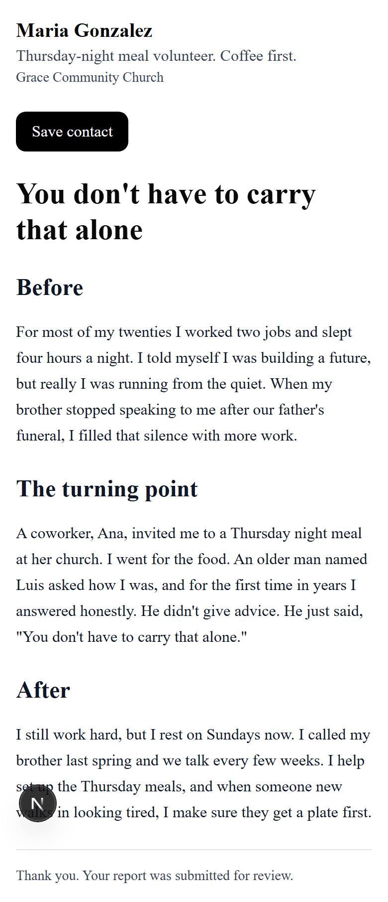
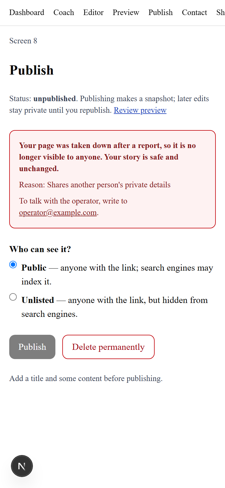
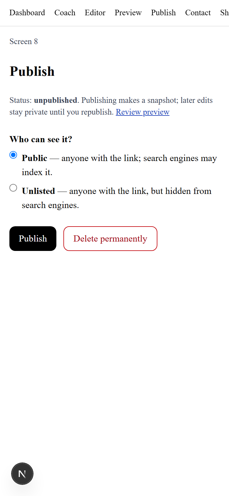

# Reports reach the operator, who can take a page down

## Summary
When someone reports a page, the operator gets a phone alert (if configured). The operator can then take the page down, or restore it, with one command. The author sees in plain words that the page was taken down, why, and how to reach the operator, and cannot simply republish.

## Context
Issue #27. Before this, reports were only stored in the `reports` table, with no alert and no takedown path (POLICY section 9 listed it as post-MVP).

## What changed
- `lib/report-notify.ts`: `notifyOperatorOfReport` POSTs plain text (page link, handle, time; no reporter text) with a `Title` header to `REPORT_WEBHOOK_URL`. 3 second timeout, never throws, logs `report_notify_failed` with a status or error name only. Called at the end of `app/api/report/route.ts` after the report is stored.
- `scripts/takedown.mjs` (+ `takedown-args.mjs`): `node scripts/takedown.mjs <handle> "<reason>" [--yes]` and `--restore`. Prints project host and action; applies only with `--yes`. Sets `status=unpublished`, `takedown_at`, `takedown_reason`; removes public media copies like the author's own Unpublish. Never touches `title`, `draft_content`, `published_content`.
- `app/api/publish/route.ts`: `publish` returns 403 with a plain message when `takedown_at` is set.
- `lib/takedown.ts` `takedownNotice(t)` + `components/TakedownNotice.tsx`: reusable author notice (message, reason, `OPERATOR_CONTACT_EMAIL` line if set). Wired into `app/(app)/publish/page.tsx` (which also disables Publish). The dashboard is being rebuilt elsewhere; it should render `<TakedownNotice notice={takedownNotice(t)} />`.
- `supabase/migrations/0003_takedown.sql`: see below.
- `docs/OPERATIONS.md`, README env table, POLICY section 9 updated.

## Decisions and alternatives
- The alert carries no reporter text at all (security review): only handle, page link and time. Reporter text stays in `reports`. https-only webhook; at most one alert per handle per hour; reports rate-limited per IP (in memory, IP not stored) and 20 per handle per hour (`lib/rate-limit.ts`, `app/api/report`).
- Columns on `testimonies` rather than a new table: the author already reads their own row through RLS, so no new policy is needed. A separate takedown history table was considered; one current state is enough for now.
- Protection against author writes is a trigger (`guard_takedown`), because the existing owner policy is `for all` and column privileges are not used elsewhere. It only blocks `anon`/`authenticated` roles, so service role, SQL editor and migrations still work.
- Restore clears the notice but leaves the page unpublished; the author republishes deliberately.
- The author's "Delete permanently" leaves takedown fields in place (the operator's decision is not erased by the author).
- Alert is awaited inside the request (max 3s) rather than fire-and-forget, because serverless functions can freeze after responding.

## Assumptions and open questions
- Owner approval of the schema change is required before applying 0002 to any hosted project.
- Dashboard notice depends on the dashboard rebuild adopting the helper.

## Interfaces, data and configuration
- Migration `0003_takedown.sql` (0002 is #40's): `testimonies.takedown_reason/takedown_at`; fail-closed trigger `guard_takedown` on insert, update and delete (privileged only for JWT role service_role, or no claims and postgres/supabase_admin/supabase_auth_admin, so account deletion still works); new `moderation_log` (RLS on, no policies, revoked from anon/authenticated); `reports.handle` added and FK now `on delete set null`; public views require `takedown_at is null`. Owner decision: keep anonymized reports and takedown log ~90 days after deletion (default implemented).
- Env (all optional): `REPORT_WEBHOOK_URL` (server-only), `OPERATOR_CONTACT_EMAIL`. Script: `SUPABASE_URL`, `SUPABASE_SERVICE_ROLE_KEY`.
- No new dependencies.

## Verification
`npm run lint`, `npm run typecheck`, `npm test` pass. New tests: `lib/report-notify.test.ts` (no PII, failure tolerance), `app/api/publish/route.test.ts` (taken-down page refused), `scripts/takedown-args.test.ts`. Verified end to end on local Supabase (2026-11-02): migration 0003 applied after 0002; report saved with handle; takedown dry run and --yes; public page, vCard and dashboard hidden; author notice shown; author PATCH/DELETE bypasses refused; report rate limit held; restore works.

Report submitted:

Author sees the takedown notice:

After restore:

## Known limitations and follow-ups
- Once #39 merges, the dashboard needs the TakedownNotice (it shows "Publish again" during a takedown today).
- No in-app operator console; no reporter feedback loop.

## Risks and rollback
The views are replaced; if 0002 misbehaves, re-create them from 0001 and drop the trigger and columns.

## Notes for future agents
If you add a new write path for `testimonies.status`, honor `takedown_at`. If you add public views, filter `takedown_at is null`.

## Related
POLICY section 9; `docs/OPERATIONS.md`.
